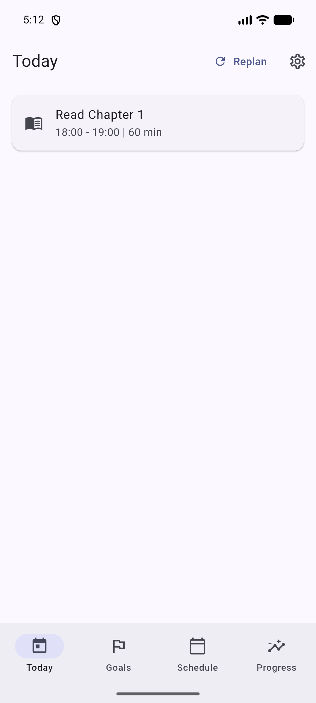
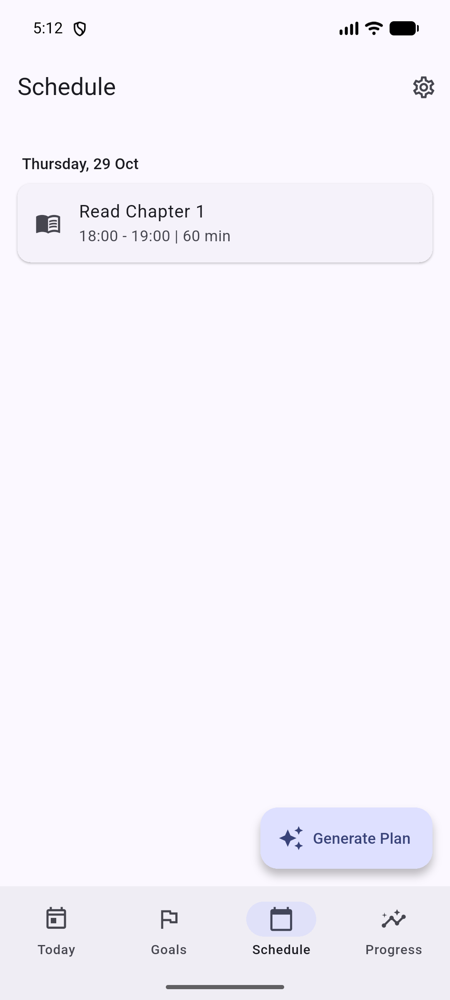
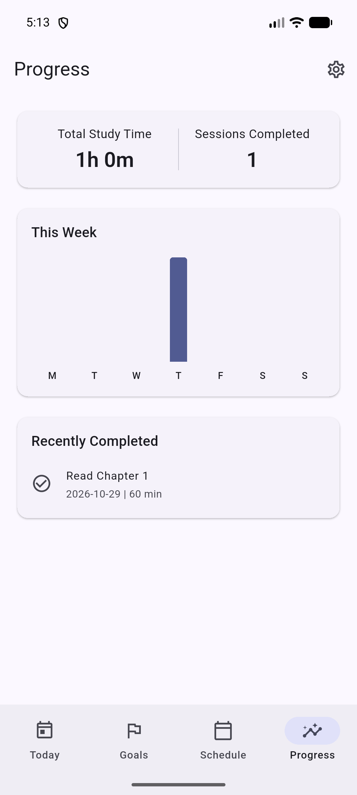
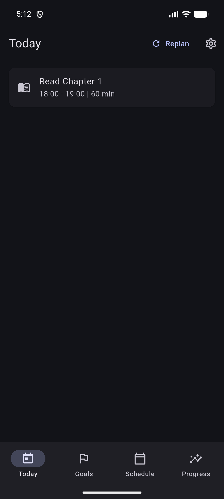

# StudyFlow - AI-Assisted Adaptive Study Planner

An offline-first study planner for Android. Turn long-term goals into subjects, topics, and tasks; let a deterministic scheduling engine convert your weekly availability into a realistic study plan; then focus, finish sessions, and watch progress build up.


## Screenshots

| Today | Schedule | Progress | Dark mode |
| :---: | :---: | :---: | :---: |
|  |  |  |  |

## Features

- **Deterministic Scheduling** — A pure-Dart engine builds study sessions from your weekly availability, block length, breaks, and daily limit. The same inputs always produce the same plan, so schedules are predictable and testable.
- **Impossible Deadline Warnings** — When a task's deadline cannot be met with the availability you have configured, the planner tells you before the session is committed.
- **Focus Timer** — Start a planned session, watch the elapsed time, and log the minutes you actually studied. Unused time returns to the task, and the plan can re-optimize automatically.
- **Progress Dashboard** — Weekly bar chart, total study time, completed sessions, and a recently completed list, all derived from real session history.
- **Offline-First** — Everything lives in a local SQLite database. No accounts, no cloud sync, no ads, and the release manifest does not request the `INTERNET` permission.
- **Revisions & Auto-Replan** — Learned topics generate spaced revisions, and stale sessions are reconciled automatically when the app resumes.

## Tech Stack

| Concern | Technology |
| --- | --- |
| Language | Dart 3 |
| UI | Flutter, Material 3 |
| State management | Riverpod |
| Navigation | go_router |
| Persistence | Drift (SQLite) |
| Testing | `flutter_test`, `integration_test` |

## Architecture Overview

StudyFlow is split into three layers:

- **UI** — Flutter widgets and Riverpod providers. Screens render state and dispatch user intents; they contain no scheduling logic.
- **Application (Services)** — `PlanService`, `ReconciliationService`, `RevisionService`, and the timer controller translate between the database and the engine, persist results, and handle side effects.
- **Core** — The deterministic scheduling engine in `lib/core/scheduling/` is pure Dart with no Flutter or database dependencies, which keeps it fully unit-testable.

```text
lib/
├── app/            # App shell, router, theme, DI providers
├── core/           # Scheduling engine, database, shared utilities
├── features/       # Goals, subjects, topics, tasks, focus, revisions
└── presentation/   # Today, Schedule, Progress, Settings screens
```

## Getting Started

### Requirements

- Flutter 3.44.x / Dart 3.12.x
- Android SDK (compile and target SDKs follow the Flutter defaults)

### Run

Start an emulator or connect a device, then:

```sh
flutter pub get
flutter run
```

To install without attaching the debugger:

```sh
flutter install --debug -d emulator-5554
```

### Test

```sh
flutter test
```

### Release build

```sh
flutter build apk --release
```

The release build enables R8 code shrinking and resource shrinking (`android/app/build.gradle.kts` + `android/app/proguard-rules.pro`). It is currently signed with the debug key so `flutter run --release` works; provide a real signing config before publishing.

Prebuilt APKs are attached to the [latest release](https://github.com/ahmed-elmosalamy/StudyFlow/releases/latest).

## Known Issues

### Emulator black screen

On some emulator quick-boot snapshots the WindowManager state gets corrupted: every app window is composited with `mShownAlpha=0.0` (the app is running and has drawn, but nothing is visible). All apps are affected; the launcher still works.

Fix:

```sh
adb reboot
```

If the problem survives a normal reboot, cold boot the emulator without loading a snapshot:

```sh
emulator -avd <name> -no-snapshot-load
```

This is an emulator/quick-boot issue, not an app bug.

## License

Released under the [MIT License](LICENSE). © 2026 Ahmed Elmosalamy.
